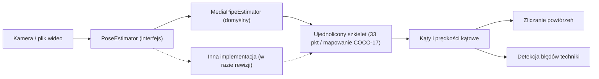

# ADR-001: Wybór biblioteki do estymacji pozy (Pose Estimation)

| Pole | Wartość |
| :--- | :--- |
| **Status** | Zaakceptowana |
| **Data** | 2026-11-26 |
| **Decydenci** | @podlaskialgorytm3, @jmBohen |
| **Powiązane zadania** | #1 *Python CV libraries analysis*, #2 *ADR python cv libraries* |
| **Materiały źródłowe** | [`benchmark_results.md`](001-python-cv-libraries-analysis/benchmark_results.md), [`technical_comparison.md`](001-python-cv-libraries-analysis/technical_comparison.md), [`summary.md`](001-python-cv-libraries-analysis/summary.md), skrypty w [`research/001-python-cv-libraries-analysis/`](../../research/001-python-cv-libraries-analysis/) |

> [!NOTE]
> Ten dokument jest formalnym rekordem decyzji. Zastępuje ocenę procentową z `summary.md`, ponieważ tamta nie opisywała kryteriów ani wag. Wszystkie dane techniczne zostały sprawdzone u źródła (patrz [§11](#11-weryfikacja-danych)).

---

## 1. Kontekst i problem

System *Inteligentny wirtualny trener personalny* ([`Opis_projektu.md`](../Opis_projektu.md)) ma na podstawie wideo z kamery smartfona:

1. **zliczać powtórzenia** – zadanie nr 1 według [`Wymagania.md`](../Wymagania.md),
2. **rozpoznawać błędy techniki** na podstawie kątów w stawach, prędkości kątowych i płaszczyzn ruchu,
3. robić to **w czasie rzeczywistym, docelowo na urządzeniu mobilnym** (*Edge AI*).

Podstawą całego przetwarzania biomechanicznego jest model **estymacji pozy**, który zwraca położenie punktów anatomicznych w każdej klatce. Ten wybór wpływa na:

- format danych w całym potoku (liczba i układ punktów, 2D czy 3D),
- możliwe metryki biomechaniczne,
- architekturę aplikacji mobilnej,
- warunki licencyjne całego produktu.

**Pytanie decyzyjne:** *Której biblioteki/modelu użyć jako głównego silnika do ekstrakcji danych biomechanicznych i zliczania powtórzeń?*

---

## 2. Czynniki decyzyjne (*Decision Drivers*)

| ID | Czynnik | Źródło |
| :--- | :--- | :--- |
| D1 | Działanie w czasie rzeczywistym (kamera 30–60 Hz) | `Opis_projektu.md` §2, §4 *Edge AI* |
| D2 | Niezawodne wykrywanie ćwiczącego w każdej klatce (ciągłość sygnału kąta) | `Opis_projektu.md` §4 *Biomechaniczna walidacja ruchu* |
| D3 | Dane 2D/3D i liczba punktów wystarczające do analizy ruchu | `Opis_projektu.md` §2 |
| D4 | Wdrożenie na Android/iOS | `Opis_projektu.md` §4 |
| D5 | Łatwa integracja w Pythonie (etap badawczy) i możliwość rozszerzeń | zespół |
| D6 | Licencja, która nie blokuje dalszego rozwoju ani dystrybucji | zespół |

---

## 3. Rozważane opcje

| Opcja | Testowane warianty | Architektura | Punkty |
| :--- | :--- | :--- | :--- |
| **A. MediaPipe Pose Landmarker** (Google) | `Lite`, `Full` | detektor (wejście 224×224) + landmarker (wejście 256×256), śledzenie osoby między klatkami | 33 (2D znormalizowane + 3D *world* w metrach) |
| **B. Ultralytics YOLO-Pose** | `YOLOv8n-pose`, `YOLO11n-pose` | jednoetapowa, wejście domyślnie 640×640 | 17 COCO (2D) |
| **C. Google MoveNet** | `Lightning` (wejście 192×192) | jednoetapowa, *single-pose*, cała klatka | 17 COCO (2D) |
| **D. OpenMMLab RTMPose** (przez `rtmlib`) | `lightweight`, `balanced` | dwuetapowa: detektor YOLOX + RTMPose (wejście 256×192) | 17 COCO (2D) |

---

## 4. Zakres badania

| Element | Opis |
| :--- | :--- |
| **Zbiór testowy** | 4 nagrania wyciskania sztangi leżąc (`bench-press-01..04`), po **150 pierwszych klatek** z każdego |
| **Sprzęt** | laptop testowy, tylko CPU |
| **Narzędzia** | `test_mediapipe.py`, `test_yolo_pose.py`, `test_movenet.py`, `test_rtmpose.py`, zbiorczy runner `benchmark_all.py` |
| **Metryki** | średnia latencja inferencji, P95 latencji, średnie FPS, odsetek klatek z wykrytą pozą (*detection rate*) |
| **Tryb MediaPipe** | `RunningMode.VIDEO`, czyli ze śledzeniem między kolejnymi klatkami. Pozostałe modele przetwarzają każdą klatkę niezależnie. |
| **Nie testowano** | MediaPipe `Heavy`; MoveNet `Thunder` (wszystkie 4 adresy modelu w `test_movenet.py` zwracają HTTP 404) |

Definicja „wykrycia pozy” w poszczególnych skryptach:

| Skrypt | Kiedy klatka liczy się jako wykryta |
| :--- | :--- |
| [`test_mediapipe.py`](../../research/001-python-cv-libraries-analysis/test_mediapipe.py) | model zwrócił pozę przy progach detekcji, obecności i śledzenia `0.5` |
| [`test_yolo_pose.py`](../../research/001-python-cv-libraries-analysis/test_yolo_pose.py#L203) | wykryto osobę z `conf ≥ 0.5` (bez progu dla pojedynczych punktów) |
| [`test_movenet.py`](../../research/001-python-cv-libraries-analysis/test_movenet.py) | co najmniej 5 punktów z pewnością `≥ 0.3` |
| [`test_rtmpose.py`](../../research/001-python-cv-libraries-analysis/test_rtmpose.py) | co najmniej 5 punktów z pewnością `≥ 0.3` |

---

## 5. Wyniki pomiarów (agregat z 4 nagrań)

Dane źródłowe dla każdego nagrania: [`benchmark_results.md`](001-python-cv-libraries-analysis/benchmark_results.md).

| Wariant | Detekcja – średnia | Detekcja – minimum (nagranie) | Śr. latencja | P95 – najgorsze nagranie | Śr. FPS | Min. FPS |
| :--- | :---: | :---: | :---: | :---: | :---: | :---: |
| **MediaPipe Lite** | **95.8%** | 84.0% (`04`) | **13.1 ms** | **25.8 ms** | **81.8** | **54.1** |
| MediaPipe Full | 89.3% | 69.3% (`04`) | 16.6 ms | 34.0 ms | 62.1 | 48.8 |
| YOLOv8n-Pose | 99.8% | 99.3% (`04`) | 87.6 ms | 181.2 ms | 11.9 | 8.8 |
| YOLO11n-Pose | 99.3% | 97.3% (`04`) | 101.0 ms | 200.3 ms | 10.4 | 8.0 |
| MoveNet Lightning | 73.7% | **34.0%** (`01`) | 5.0 ms | 10.4 ms | 203.6 | 176.3 |
| RTMPose lightweight | 99.7% | 99.3% (`01`, `04`) | 223.3 ms | 431.1 ms | 4.8 | 3.2 |
| RTMPose balanced | 100.0% | 100.0% | 1131.2 ms | 1586.3 ms | 0.9 | 0.8 |

Budżet czasu rzeczywistego: **33.3 ms na klatkę przy 30 FPS**.

### 5.1. Parametry techniczne (zweryfikowane)

| | MediaPipe | YOLO-Pose | MoveNet | RTMPose |
| :--- | :--- | :--- | :--- | :--- |
| **Rozmiar modelu** | Lite 5.8 MB, Full 9.4 MB, Heavy 30.7 MB (`.task`) | v8n 6.8 MB, 11n 6.3 MB (`.pt`) | Lightning FP16 4.8 MB (`.tflite`) | lightweight ~39 MB, balanced ~145 MB (archiwa ONNX, detektor + pose) |
| **Platformy** | oficjalne SDK: Android, iOS, Web, Python, Flutter | Python; eksport do LiteRT/TFLite, CoreML, ONNX, NCNN i innych | TFLite / TF.js | ONNX (`rtmlib`) |
| **Dotrenowanie** | brak (MediaPipe Model Maker obsługuje tylko *gesture recognizer*, *image classifier*, *object detector*) | tak (`yolo pose train …`) | brak oficjalnego narzędzia | tak (ekosystem `mmpose`) |
| **Licencja** | Apache 2.0 | AGPL-3.0 lub płatna Ultralytics Enterprise | Apache 2.0 | Apache 2.0 (`mmpose`, `rtmlib`) |

---

## 6. Kryteria oceny

Ocena przebiega w dwóch krokach:

1. **Bramki (*must-have*)** – odrzucają opcje, które nie spełniają minimalnych wymagań.
2. **Kryteria ważone** – szeregują opcje na skali 1–5.

### 6.1. Bramki (*must-have*)

| ID | Bramka | Próg |
| :--- | :--- | :--- |
| **B1** | Niezawodność detekcji ćwiczącego | średnio **≥ 85%** klatek **i ≥ 50%** na każdym nagraniu |
| **B2** | Czas rzeczywisty | średnio **≥ 30 FPS** na każdym nagraniu na sprzęcie testowym (CPU) |
| **B3** | Licencja | pozwala rozwijać i rozpowszechniać aplikację; licencja copyleft (AGPL) dopuszczona warunkowo, wymaga decyzji zespołu |

### 6.2. Kryteria ważone i skala ocen (1–5)

| ID | Kryterium (czynnik) | Waga | 5 pkt | 3 pkt | 1 pkt |
| :--- | :--- | :---: | :--- | :--- | :--- |
| **K1** | Latencja na CPU (D1) | **25%** | P95 ≤ 33.3 ms na każdym nagraniu | 15–30 FPS (4 pkt: śr. ≤ 33.3 ms, ale P95 > 33.3 ms; 2 pkt: 8–15 FPS) | < 8 FPS |
| **K2** | Stabilność detekcji (D2) | **20%** | minimum ≥ 99% | minimum ≥ 80% (4 pkt: ≥ 95%; 2 pkt: ≥ 50%) | minimum < 50% |
| **K3** | Reprezentacja szkieletu (D3) | **15%** | ≥ 33 punkty z dłońmi/stopami + 3D | 17 punktów + 3D lub rozszerzone punkty w tym samym modelu (2 pkt: tylko 17 punktów 2D) | < 17 punktów |
| **K4** | Łatwość integracji i rozszerzalność (D5) | **10%** | `pip install`, jeden model, proste API **i** możliwość dotrenowania | ręczny pre/post-processing **lub** brak oficjalnego źródła wag (4 pkt: proste API bez dotrenowania) | (2 pkt: potok dwumodelowy) |
| **K5** | Wdrożenie mobilne (D4) | **20%** | oficjalne SDK Android/iOS lub natywny TFLite, model < 10 MB | eksport do formatów mobilnych, brak oficjalnego SDK | potok dwumodelowy, > 35 MB |
| **K6** | Licencja (D6) | **10%** | Apache 2.0 / MIT | LGPL lub inne istotne ograniczenia (2 pkt: AGPL-3.0) | licencja zamknięta / niekomercyjna |

Uzasadnienie wag: K1 i K5 łącznie mają 45%, bo projekt zakłada **feedback w czasie rzeczywistym na telefonie** (`Opis_projektu.md` §4).

---

## 7. Macierz decyzyjna

### 7.1. Bramki

| Opcja | B1 (detekcja) | B2 (≥ 30 FPS) | B3 (licencja) | Wynik |
| :--- | :---: | :---: | :---: | :--- |
| **A. MediaPipe** | ✅ 95.8% / min 84% (Lite) | ✅ 54–108 FPS | ✅ Apache 2.0 | **przechodzi** |
| **B. YOLO-Pose** | ✅ 99%+ | ❌ 8–16 FPS | ⚠️ AGPL-3.0 | **odrzucona** (B2) |
| **C. MoveNet Lightning** | ❌ 73.7% / **min 34%** | ✅ 176–225 FPS | ✅ Apache 2.0 | **odrzucona** (B1) |
| **D. RTMPose** | ✅ 99.7%+ | ❌ 0.8–6.2 FPS | ✅ Apache 2.0 | **odrzucona** (B2) |

### 7.2. Kryteria ważone

Oceny liczone są dla najlepszego testowanego wariantu: MediaPipe → `Lite`, YOLO → `v8n`, RTMPose → `lightweight`.

| Kryterium | Waga | A. MediaPipe | B. YOLO-Pose | C. MoveNet | D. RTMPose |
| :--- | :---: | :---: | :---: | :---: | :---: |
| K1 Latencja | 25% | **5** (P95 ≤ 25.8 ms) | 2 (śr. 11.9 FPS) | **5** (P95 ≤ 10.4 ms) | 1 (śr. 4.8 FPS) |
| K2 Stabilność detekcji | 20% | 3 (min 84%) | **5** (min 99.3%) | 1 (min 34%) | **5** (min 99.3%) |
| K3 Reprezentacja | 15% | **5** (33 pkt + 3D) | 2 | 2 | 2 |
| K4 Integracja | 10% | 4 (proste *Tasks API*, brak dotrenowania) | **5** | 3 (ręczny pre/post-processing; oficjalny URL wag zwraca 404) | 2 (detektor + pose) |
| K5 Mobile | 20% | **5** (SDK Android/iOS, 5.8–9.4 MB) | 3 (eksport LiteRT/CoreML) | **5** (TFLite, 4.8 MB) | 1 (2 modele, 39–145 MB) |
| K6 Licencja | 10% | **5** | 2 | **5** | **5** |
| **Wynik (0–5)** | | **4.50** | 3.10 | 3.55 | 2.45 |
| **Wynik (%)** | | **90%** | 62% ❌ B2 | 71% ❌ B1 | 49% ❌ B2 |

### 7.3. Analiza wrażliwości

| Zestaw wag (K1/K2/K3/K4/K5/K6) | MediaPipe | YOLO-Pose | MoveNet | RTMPose |
| :--- | :---: | :---: | :---: | :---: |
| Bazowy (25/20/15/10/20/10) | **90%** | 62% | 71% | 49% |
| Priorytet stabilności detekcji (15/35/15/10/15/10) | **84%** | 70% | 59% | 61% |
| Przetwarzanie offline na serwerze (20/40/20/20/0/0) | **80%** | 76% | 48% | 60% |
| Wagi równe | **90%** | 63% | 70% | 53% |

MediaPipe wygrywa przy każdym zestawie wag. Najmniejsza przewaga (4 pkt proc. nad YOLO) występuje przy przetwarzaniu offline na serwerze, czyli w scenariuszu, którego projekt nie zakłada.

---

## 8. Decyzja

> [!IMPORTANT]
> **Głównym silnikiem estymacji pozy jest MediaPipe Pose Landmarker (*Tasks API*), w wariancie `Lite` jako domyślnym.**

Szczegóły decyzji:

1. **Wariant:** domyślny jest `Lite`. W testach był lepszy od `Full` zarówno w szybkości (81.8 vs 62.1 FPS), jak i w detekcji (95.8% vs 89.3%).
2. **Tryb pracy:**
   - `RunningMode.VIDEO` do analizy nagrań,
   - `RunningMode.LIVE_STREAM` w aplikacji (strumień z kamery).
3. **Dane wyjściowe:**
   - 33 punkty w obu układach: 2D znormalizowane do rozmiaru obrazu oraz 3D *world* w metrach (początek układu w środku między biodrami),
   - pole `visibility` każdego punktu służy do odrzucania niepewnych pomiarów.
4. **Warstwa abstrakcji:**
   - Potok biomechaniczny nie korzysta z MediaPipe bezpośrednio, tylko przez wewnętrzny interfejs `PoseEstimator`, który zwraca ujednolicony szkielet.
   - Moduł zawiera mapowanie BlazePose-33 → COCO-17 (indeksy `0, 2, 5, 7, 8, 11–16, 23–28`).
   - Dzięki temu można podmienić model bez przepisywania logiki zliczania i oceny techniki.
5. **Śledzenie toru sztangi nie jest objęte tym ADR.** Wymaga osobnego detektora obiektów i osobnej decyzji (ADR-00X). Kandydaci:
   - Ultralytics YOLO – AGPL-3.0,
   - MediaPipe Model Maker *object detector* – Apache 2.0,
   - YOLOX – Apache 2.0,
   - RTMDet (`mmdetection`) – Apache 2.0.

### 8.1. Dlaczego nie pozostałe opcje

- **YOLO-Pose:** stabilna detekcja (min. 99.3%) i łatwe dotrenowanie, ale:
  - na CPU osiąga 8–16 FPS, więc nie przechodzi bramki B2,
  - zwraca tylko 17 punktów 2D,
  - licencja AGPL-3.0 wymaga otwarcia kodu aplikacji albo zakupu licencji Enterprise.
- **MoveNet Lightning:** najszybszy i najlżejszy, ale:
  - na `bench-press-01` wykrył pozę tylko w 34% klatek, więc nie przechodzi bramki B1,
  - oficjalny adres modelu zwraca 404; skrypt pobiera plik z prywatnego repozytorium (`arunponnusamy/movenet-tensorflow`).
- **RTMPose:** najwyższa stabilność detekcji, ale potok dwumodelowy osiąga 0.8–6.2 FPS na CPU, więc nie przechodzi bramki B2.

---

## 9. Konsekwencje

### 9.1. Pozytywne

- **Czas rzeczywisty z zapasem:** 54–108 FPS na CPU laptopa, czyli 1.8–3.6× więcej niż wymaga nagranie 30 FPS.
- **Więcej punktów:** pięty i palce stóp (wśród 33 punktów) oraz współrzędne 3D *world* w metrach.
- **Jedna technologia od badań do produkcji:** ten sam model `.task` działa w Pythonie, na Androidzie, iOS, Web i we Flutterze.
- **Licencja Apache 2.0:** brak obowiązku otwierania kodu i opłat.
- **Mały model:** 5.8 MB (`Lite`) / 9.4 MB (`Full`).

### 9.2. Negatywne i kompromisy

| Kompromis | Skutek | Mitygacja |
| :--- | :--- | :--- |
| **Brak dotrenowania modelu pozy** (Model Maker nie obsługuje Pose Landmarkera) | Nie można douczyć modelu na nagraniach z siłowni ani dodać własnych punktów | Śledzenie sztangi osobnym detektorem (ADR-00X); w razie potrzeby wymiana modelu przez interfejs `PoseEstimator` |
| **Słabsza detekcja na nagraniu `bench-press-04`** (84% Lite / 69% Full, wobec 97–100% u YOLO i RTMPose) | Brakujące klatki w sygnale kąta | Wytyczne ustawienia kamery dla każdego ćwiczenia (`docs/exercises/`); logika zliczania musi tolerować brakujące klatki |
| **Wyniki dotyczą tylko wyciskania leżąc** | Brak pomiarów dla OHP, podciągania i pompek | Powtórzyć benchmark (`benchmark_all.py`) po nagraniu tych ćwiczeń |

### 9.3. Wpływ na architekturę

---

## 10. Warunki rewizji decyzji

Decyzję należy ponownie rozpatrzyć (nowy ADR zastępujący ADR-001), jeśli:

1. na nagraniach innych ćwiczeń detekcja MediaPipe spadnie poniżej progu bramki B1,
2. na docelowym telefonie MediaPipe nie osiągnie 30 FPS,
3. pojawi się wymaganie dotrenowania modelu szkieletu lub analizy wielu osób jednocześnie.

---

## 11. Weryfikacja danych

Stan na 2026-11-26.

| Dane | Źródło weryfikacji |
| :--- | :--- |
| Wyniki FPS, latencji i detekcji | [`benchmark_results.md`](001-python-cv-libraries-analysis/benchmark_results.md); agregaty (średnia/min/max) przeliczone z tabel źródłowych |
| Definicje „wykrycia” i tryb `VIDEO` | kod skryptów w `research/001-python-cv-libraries-analysis/` |
| Rozmiary modeli | nagłówki `Content-Length` plików pobieranych przez skrypty (MediaPipe, YOLO, MoveNet) i przez `rtmlib` (RTMPose) |
| Niedostępność MoveNet Thunder i oficjalnego URL-a Lightning | odpowiedzi HTTP 404 dla adresów w `test_movenet.py` |
| Wejścia sieci, platformy, `num_poses`, układ współrzędnych *world* | [dokumentacja MediaPipe Pose Landmarker](https://ai.google.dev/edge/mediapipe/solutions/vision/pose_landmarker) |
| Brak dotrenowania w MediaPipe | zawartość `mediapipe/model_maker/python/vision` (`gesture_recognizer`, `image_classifier`, `object_detector`) |
| Formaty eksportu i domyślne `imgsz=640` w YOLO | [Ultralytics export](https://docs.ultralytics.com/modes/export/), `ultralytics/cfg/default.yaml` |
| Dotrenowanie YOLO-Pose | [Ultralytics Pose](https://docs.ultralytics.com/tasks/pose/) |
| Licencje | PyPI (`mediapipe`, `ultralytics`, `rtmlib`), GitHub API (`mmpose`, `mmdetection`, `YOLOX`, `mediapipe`, `ultralytics`), Kaggle Models (`google/movenet`: Apache 2.0), [ultralytics.com/license](https://www.ultralytics.com/license) |
