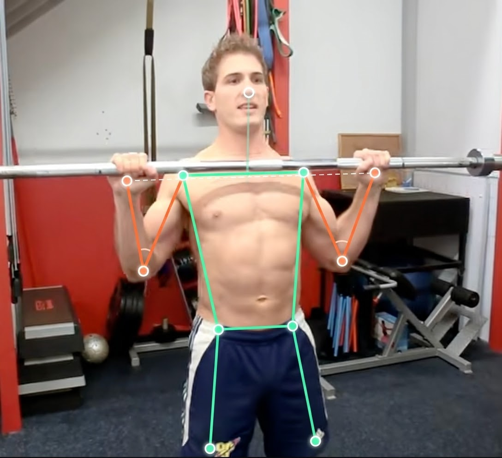
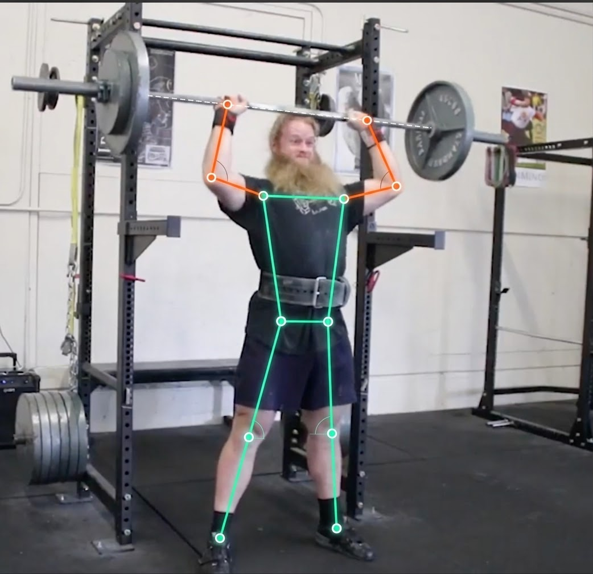

# Overhead Press (OHP) Recording Guide

Follow this guide to record clear, consistent footage for accurate 2D pose estimation, strict rep counting, and form analysis during the standing barbell overhead press.

## Camera Setup

| Parameter | Recommendation |
| :--- | :--- |
| **Angle** | **Front diagonal (~30–45° off-center from the front)** |
| **Height** | **Waist to chest level** (90–120 cm / 3–4 ft) on a tripod or bench (floor level angled slightly upward is an acceptable fallback) |
| **Orientation** | **Portrait** (required to capture full vertical travel from feet to overhead lockout) |
| **Distance** | **2.5–3.5 m** (far enough to keep both feet and fully locked-out hands inside the frame) |
| **Framing** | Full body visible from ankles/feet up to full overhead reach (~15–20% margin above the wrists at lockout) |

## What the Model Tracks

From a ~30–45° front-diagonal view, the system evaluates five key signals simultaneously:

* **Exact Rep Counting (Full Cycle):** A rep is only counted when the complete cycle is met:
  1. **Start (Rack Position):** Wrists are at collarbone/chin level with tightly bent elbows (~50–80°, `Shoulder → Elbow → Wrist`).
  2. **Top Trigger (Overhead Lockout):** Both elbows extend to ~165–175° with both wrists clearly above the head line.
  3. **Finish:** Controlled descent back to the collarbone/chin rack position. Half-reps that fail to reach lockout or drop short of the start position are rejected.
* **Leg Drive / Push-Press Detection (`Hip → Knee → Ankle`):** Tracks knee angle right before and during the press. If the knees bend below ~170° to generate upward momentum, the rep is flagged as a push press rather than a strict OHP.
* **Torso Lean & Swaying (`Shoulder → Hip → Knee → Ankle`):** Thanks to the ~30–45° angle, excessive backward layback, lower-back hyperextension, or forward hip thrust appears as measurable torso-to-hip angulation and horizontal hip shift.
* **Pressing Symmetry & Bar Levelness (`Left/Right Wrist → Elbow → Shoulder`):** Tracks the dashed horizontal wrist line and compares bilateral elbow angles to flag uneven pressing or bar tilt.
* **Forearm Alignment (`Elbow → Wrist`):** Checks whether the elbows stay stacked beneath the wrists in the starting rack position rather than flaring excessively or dropping far behind the bar.

> **Why ~30–45° from the front?** A pure side (90°) view causes large barbell plates to block the shoulder and elbow in the bottom rack position and hides left-right asymmetry. A pure front (0°) view hides backward torso lean and knee dip. A ~30–45° front diagonal avoids plate occlusion while capturing full-body form from a single camera.

### Pose Tracking Examples

*Rack phase: tracking starting elbow flexion, stacked wrists over elbows, and horizontal bar alignment.*

*Pressing phase: tracking bilateral elbow extension, bar symmetry, torso stability, and locked-out knees (`Hip → Knee → Ankle`).*

## What to Pay Attention To

* **Leave Generous Headroom:** Make sure there is plenty of empty space above your head while standing—if your wrists exit the top edge of the frame at lockout, the rep counter cannot confirm completion.
* **Keep Knees & Ankles Fully Visible:** Cropping out the lower body (like close-up upper-body shots) disables push-press / leg-drive detection and weakens torso-lean tracking.
* **Avoid Plate & Rack Occlusion:** Stand far enough outside the rack uprights (or angle the camera cleanly) so squat-rack posts and weight plates do not cross directly over your elbows or shoulders.
* **Fixed Camera Position:** Keep the phone stationary on a bench or tripod. Handheld camera movement creates false torso-sway and bar-tilt readings.
* **Hold a 1–2s Static Start:** Pause still in the front-rack position with locked knees before pressing your first rep so the model locks onto your baseline rack height and vertical alignment.
* **Clear Background Contrast:** Avoid dark clothing directly against dark power-rack uprights if possible, so hip and knee keypoints stay sharp throughout the set.

## Reference Videos

* **Video 1 – Ideal Full-Body Angle & Technique (Alan Thrall – Untamed Strength, key angle starts around 1:50):** (https://www.youtube.com/watch?v=wJlKUo2-P4o&t=110s)
* **Video 2 – Full-Body 45° Front-Diagonal Reference (NASM):** (https://www.youtube.com/watch?v=cGnhixvC8uA)
* **Video 3 – Upper-Body Rack & Pressing Mechanics Reference (ScottHermanFitness, note: legs cropped out):** (https://www.youtube.com/watch?v=2yjwXTZQDDI)
