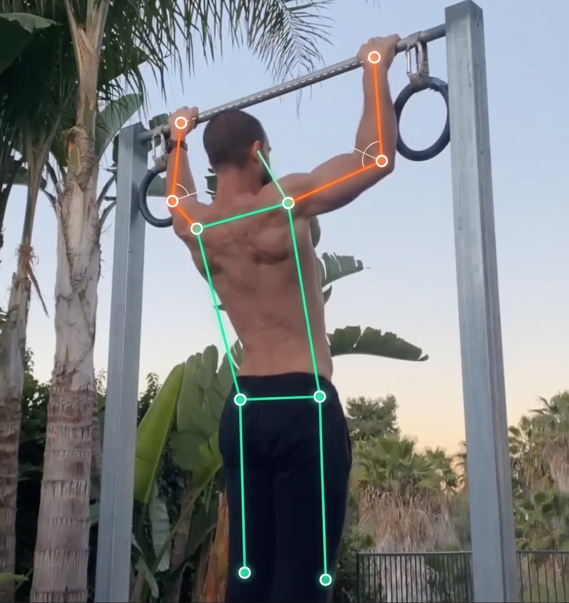
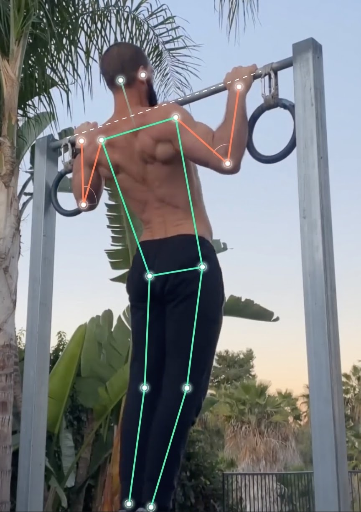

# Pull-Up Recording Guide

Follow this guide to record clear, consistent footage for accurate 2D pose estimation, strict rep counting, and form analysis.

## Camera Setup

| Parameter | Recommendation |
| :--- | :--- |
| **Angle** | **Rear diagonal (~25–30° off-center behind your back)** |
| **Height** | **Floor to waist level** (0–90 cm / 0–3 ft), slightly angled upward if placed on the floor |
| **Orientation** | **Portrait** (required to capture full vertical travel) |
| **Distance** | **2.5–3.5 m** (wide enough to keep hands on the bar and feet in frame) |
| **Framing** | Full body visible from above the head at peak pull down to the feet at full dead hang (~15% margin top and bottom) |

## What the Model Tracks

From a ~25–30° rear-diagonal view, the system evaluates four key signals simultaneously:

* **Exact Rep Counting (Full Cycle):** A rep is only counted when the full movement cycle is completed:
  1. **Start (Bottom Lockout):** Both elbows extend to ~160–175° (`Wrist → Elbow → Shoulder`).
  2. **Top Trigger:** The chin-over-bar threshold is crossed.
  3. **Finish:** Controlled return to bottom elbow lockout (~160–175°). Partial reps (half-reps) that do not reach either threshold are rejected.
* **Chin-Over-Bar Detection (`Head / Ears` vs. `Bar Line`):** Because the camera is behind you, the chin itself is occluded. The model detects chin-over-bar by establishing a horizontal reference line between both wrists on the bar and verifying that the head/ear keypoints rise clearly above that line at the top of the pull.
* **Swing & Kipping Detection (`Shoulder → Hip → Knee → Ankle`):** Thanks to the ~25–30° rear angle, any forward/backward swinging, hip kipping, or knee drive shows up as measurable horizontal shift of the hips and legs away from the vertical anchor line beneath the bar.
* **Pulling Symmetry (`Left Shoulder ↔ Right Shoulder`):** Compares left and right shoulder elevation and elbow angles to flag uneven pulling.

> **Why ~25–30° from behind?** A straight rear (0°) view hides forward-and-back swinging, while a pure side (90°) view hides left-right asymmetry and gets blocked by rack uprights. This slight diagonal captures rep depth, chin clearance, symmetry, and body swing from a single camera.

### Pose Tracking Examples

*Lower phase: verifying bilateral elbow extension, shoulder symmetry, and vertical hip/leg alignment.*

*Top phase: head/ears crossing the horizontal wrist reference line (chin-over-bar trigger) with controlled leg position.*

## What to Pay Attention To

* **Keep Top Margin Above the Bar:** Leave enough space above the bar in the frame so your head and ears stay fully visible when your chin clears the bar—otherwise the top rep trigger will fail.
* **Keep Feet & Knees in Frame at Dead Hang:** If the lower legs are cropped out, the model cannot accurately separate a clean strict pull-up from leg kick or hip swing.
* **No Rack Occlusion on Arms:** Make sure upright posts, rings, or bands do not pass in front of your wrists, elbows, or shoulders during the set.
* **Fixed Camera Position:** Place the phone on a stable surface or tripod. Handheld movement shifts the bar reference line and creates false swing detections.
* **Start With a 1–2s Dead Hang:** Hang still with straight arms before your first rep so the model locks onto your baseline bar height, lockout angle, and neutral vertical line for swing detection.
* **Avoid Strong Backlight:** Don't film directly into bright sun or overhead spotlights right behind the bar, as heavy silhouettes degrade wrist and ear tracking near the bar.

## Reference Videos

* **Video 1 – Ideal Camera Angle & Form Reference (K boges):** (https://www.youtube.com/watch?v=zuf5qRaFr-8)
* **Video 2 – Front view lets test which better suit the model (K boges):** (https://www.youtube.com/watch?v=2SkV-3ckG0s)