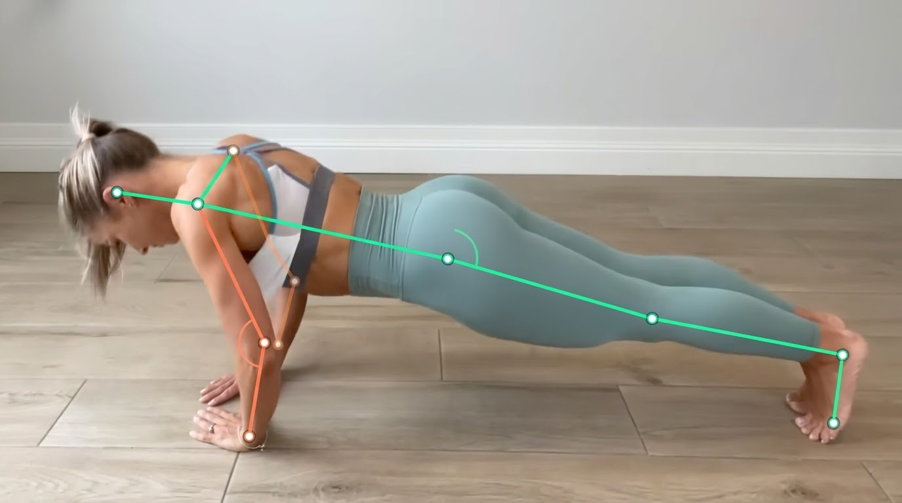
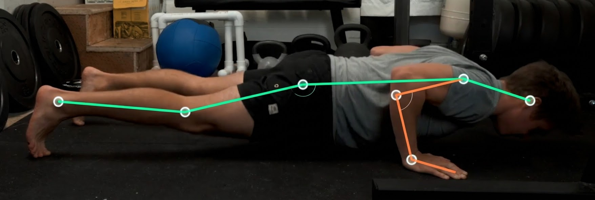

# Push-Up Recording Guide

Follow this guide to record clear, consistent footage for accurate 2D pose estimation and form analysis.

## Camera Setup

| Parameter | Recommendation |
| :--- | :--- |
| **Angle** | Strict **90° side profile** (perpendicular to your body) |
| **Height** | **Floor level** (5–15 cm / 2–6 in), propped against a wall, bottle, or weight |
| **Orientation** | **Landscape** (preferred) or Portrait |
| **Distance** | **2–2.5 m** (landscape) or **3–3.5 m** (portrait) |
| **Framing** | Full body visible from head to toes with ~15% margin on both sides |

## What to Expect

Once you upload or stream your video, the model tracks key joints on the side of your body facing the camera and evaluates two primary movement chains:

* **Repetition Count & Depth (`Shoulder → Elbow → Wrist`):** Measures elbow flexion to detect full lockout at the top (~165–175°) and sufficient depth at the bottom (≤ 90°).
* **Body Alignment (`Ear → Shoulder → Hip → Knee → Ankle`):** Tracks your torso and leg line to flag hip sagging, piking (hips too high), or head drop.

> **Note:** From a pure side view, the model intentionally relies on the arm and leg closest to the camera, as the far side is naturally occluded.

### Pose Tracking Examples

*Top position: arms locked out (~165–175° elbow angle) with a straight body line from ear to ankle.*

*Bottom position: elbow angle drops to ≤ 90° while maintaining neutral hip alignment.*

## What to Pay Attention To

* **Clear Line of Sight:** Make sure no gym equipment, benches, or dumbbells sit between the camera and your body.
* **Camera Stability:** Place the phone on a solid surface—avoid handheld recording, as camera shake reduces joint-tracking accuracy.
* **Clothing & Contrast:** Wear fitted athletic clothes that contrast with the background. Very loose shirts or dark clothes against a dark floor can hide your hip and elbow positions.
* **Lighting:** Record in a well-lit area without strong backlighting (avoid placing the camera directly facing a bright window).
* **Stay Perpendicular:** Keep your body aligned parallel to the camera lens throughout the set—avoid angling diagonally toward or away from the lens.
* **Pause Briefly Before Starting:** Hold the top plank position for 1–2 seconds before your first rep so the system can lock onto your posture cleanly.

## Reference Videos

* **Video 1 – Different angles & types of pushups:** (https://www.youtube.com/watch?v=tWjBnQX3if0 3:01)
* **Video 2 – Perfect side view pushup:** (https://www.youtube.com/watch?v=hAhCweMfrF8 2:07)